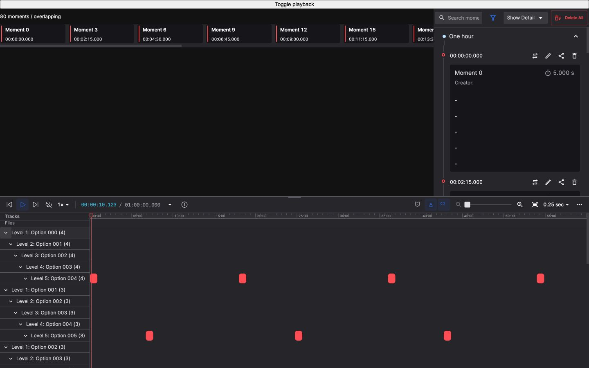
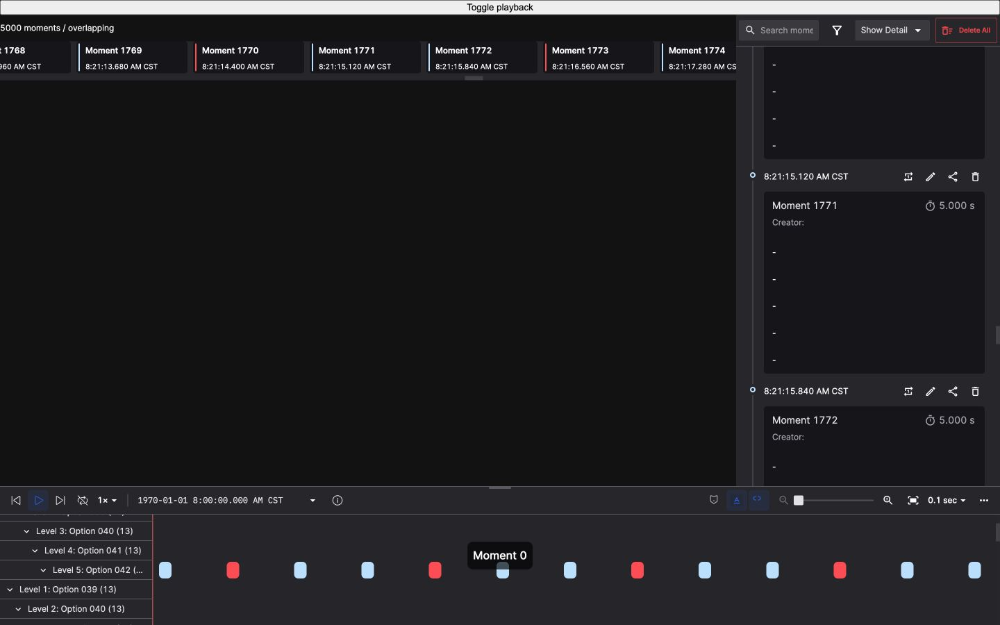
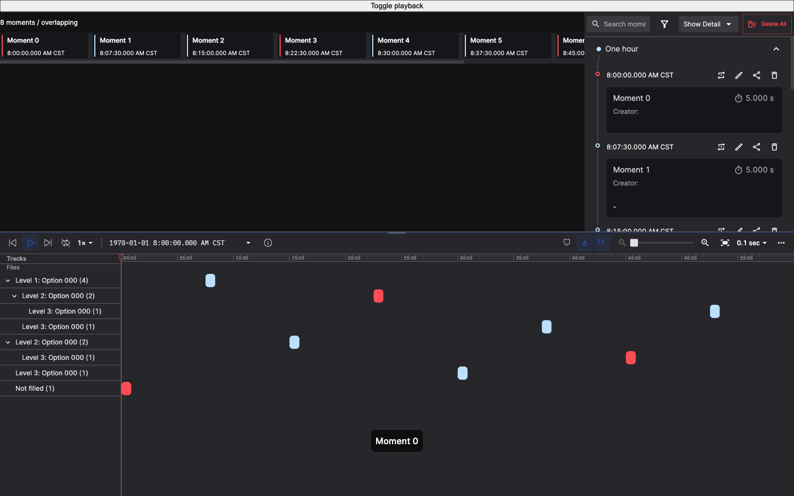

# Moment 分组时间轴：桌面验证记录

日期：2026-10-19，2026-10-20 补充可选字段修复验证。基于 Honeybee `53ff795f9`；桌面验证尺寸为 1440 × 900。

## 行为与兼容边界

- 迁移 Bombus #252–256 的通用时间轴工具栏、缩放、步长位置、80vh 高度上限、相对时间和疑似项能力。保留 Honeybee 的权限、归档、关键帧搜索、实时播放与影子模式逻辑。
- 项目 Moment schema 的 `groupingRules` 决定最多五级单选字段。只生成有数据的路径；路径中的字段/选项 ID 决定身份。字段或选项改名不会清除折叠状态；未知和已删除选项保留为可见分组。
- 空字段不创建占位层级，Moment 挂在最后一个已填写字段上；所有字段为空时，在根层共用一条“未填写”轨道。A、C 有值而 B 为空时，路径为 A → C；A、B 为空而 C 有值时，C 位于根层。同一分组可以同时拥有自己的 Moment 和子分组，计数包含自身及后代。
- 同级按 NFC 规范化后的 UTF-16 名称排序，再以 ID 打破同名平局；未知项和缺失项依次置后。没有排序字段、排序写入接口或本地分组配置回退。
- 各层自身的 Moment 复用已有排轨和吸附逻辑，重叠条目分行，再依次放置子分组；标签和条形共享布局、滚动与拖动预览。只有实际存在子分组的节点能展开/折叠；折叠隐藏自身轨道及后代，只改变视图，不拆分或删除 Moment。叶子没有展开控件，旧的叶子折叠标记不影响绘制、导航、悬停和吸附；过滤后变成叶子的节点同样适用。
- `_doubtful` 仅在值为字符串 `true` 时生效，显示为 `#FF4D4F`。侧栏、横向列表和时间轴共享过滤投影，完整 store 继续用于编辑和 Delete All；隐藏轨道不参与时间轴导航和吸附。字幕沿用其独立的全记录逻辑。
- 相对时间使用当前数据源起点，输入以纳秒恢复绝对时间；显示可超过 24 小时。原始消息、API、导出与分享时间戳不改变；保留 #1537 的文件起点查询精度修复。

## 工程验证

- `yarn install --immutable` 成功，未修改依赖或锁文件。
- `yarn test --runInBand`：2026-10-20 叶子展开修复后，345 个 suite、3,542 个测试及 38 个 snapshot 通过；1 个原有跳过项。此前并行构建/检查期间出现的存储封存超时测试失败，隔离及最终全量串行重跑均通过，未改动该存储实现。
- `yarn typecheck:ci`、`yarn typecheck:tooling:ts6`、`yarn lint:ci`、`git diff --check` 通过。
- Web 生产构建通过（2 个 bundle 大小警告）；独立 Moment 生产构建通过（3 个 bundle 大小建议）。
- 回归覆盖：五级与无分组、旧协议/缺失规则、改名/删除/历史多选、稳定排序、折叠/重叠/拖动预览、虚拟滚动、过滤与批量操作、隐藏轨道导航/吸附、项目 schema 请求竞争、相对时间纳秒与长时长、窗口失焦/取消/卸载清理，以及文件首尾边界。
- 可选字段修复先在旧实现上复现 4 个失败用例，再通过全部 A/B/C 填写组合、五级全部为空、空值中断后的已填字段、父层自身轨道与子分组并存、父层重叠拖动预览，以及展开/折叠后的键盘导航和悬停回归。定向测试 4 个 suite、59 个测试通过；重新运行 `yarn typecheck:ci`、`yarn lint:ci` 和独立 Moment 生产构建通过（3 个 bundle 大小建议）。
- 叶子展开修复先在旧实现上复现 10 个失败用例，修复后定向测试 4 个 suite、67 个测试通过。覆盖仅父分组提供按钮、叶子没有可聚焦的展开控件、旧折叠标记、无规则/全空根轨道，以及过滤后父节点变成叶子的情况。

## 浏览器验证

使用 Codex 内置浏览器、最终生产构建和本地合成 fixture，无后端网络或解码：

- 80 条、五级、8 条占用路径：切换相对时间后，侧栏与横向列表一致更新；输入 `00:00:10.123456789` 成功定位，显示精度为毫秒。
- 疑似项过滤后，三处视图只呈现对应条目，条形颜色为 `rgb(255, 77, 79)`。折叠根分组隐藏其全部子分组和条形，展开恢复。
- 步长 Enter 保存 `0.25`；Escape 放弃 `1`，保留 `0.25`。两次均将键盘焦点恢复到步长按钮。
- 5,000 条、五级、400 条占用路径：完整布局高度 56,000px；滚动 5,400px 后仅挂载 12 个标签，标签/条形内容的 top 均为 -4,625px。证明当前视图虚拟化和位置一致，不代表帧率达标。
- 5,000 条、五级、2 条占用路径：同一叶分组出现多个条形行，标签高度与已有排轨结果一致。
- 最后浏览器检查未捕获 warning/error。原始 DOM 检查结果见 [desktop-checks.json](results/moment-grouping-2026-10-19/desktop-checks.json)。





2026-10-20 可选字段桌面补充：

- 8 条 Moment、三级、单一选项，覆盖全部填写组合：8 条轨道各显示一条 Moment；A、A → B、A → B → C 同时显示，空字段不增加缩进。
- 折叠 A 后，隐藏 A 自身及其后代的 4 条 Moment，剩余 4 条；展开恢复全部 8 条。
- 叶子展开修复后，同一示例仅 3 个父节点提供展开按钮，5 个叶子无按钮；点击叶子仍显示 8 条 Moment，父节点折叠/恢复行为保持不变。截图已更新为这一状态。localhost 真实记录的“一刻 (5)”叶子根轨道也正常显示 5 条条形、没有展开按钮，之前保存的折叠标记不再隐藏数据。
- 64 条 Moment、五级、长时间重叠：各节点拥有两条直接 Moment，标签高度为 56px；共享容器滚动到 1,200px 后只挂载 7 个标签，12 条挂载条形均落在对应标签行的范围内。这里通过调试接口设置滚动位置，验证虚拟化及布局对齐，不作为滚轮输入或帧率验收。
- 未捕获浏览器 warning/error。原始几何记录见 [desktop-checks.json](results/moment-optional-fields-2026-10-20/desktop-checks.json)。这些数据为合成 fixture，不改写真实项目字段或 Moment。



## 协议与验收限制

当前使用 Mono #3420 `e791975c8db3ae5bcb27b474819e5056e8344504` 中原样生成的协议快照，对应 cosceneapis #862 `f99439c36452eb76cd60e68d6d8bf5596fb7613a`。已逐文件比较，只有 Moment schema 读取使用新描述符，继续通过原有鉴权 transport。来源及替换方法见 [协议说明](../packages/studio-base/src/services/api/moment-custom-field/README.md)。

本次核对时两个依赖 PR 均未合并；已发布 SDK 0.0.487 尚不含该协议。旧后端无规则时展示未分组视图。这里不提供后端部署、真实 schema 保存/重开、跨项目权限、真实记录长时间运行或 Electron 打包验收结论，也没有重做 [既有性能验收矩阵](MOMENT_PERFORMANCE.md)。

复现桌面预览：

```sh
yarn rspack build --mode production --config benchmark/moments.rspack.config.ts
python3 -m http.server 8917 --bind 127.0.0.1 --directory benchmark/.webpack-moments
```

打开 `http://127.0.0.1:8917/?count=80&distribution=overlapping&extras=true&groupLevels=5&groupCount=8`；压力示例改为 `count=5000&groupCount=400`。`groupLevels=0` 可检查旧后端无分组状态。

可选字段示例：`http://127.0.0.1:8917/?count=8&distribution=overlapping&extras=true&groupLevels=3&groupCount=1&optionalFields=true`。`optionalFields=true` 按索引位依次覆盖字段填写组合；五级重叠示例使用 `count=64&distribution=long&groupLevels=5&groupCount=1&optionalFields=true`。
